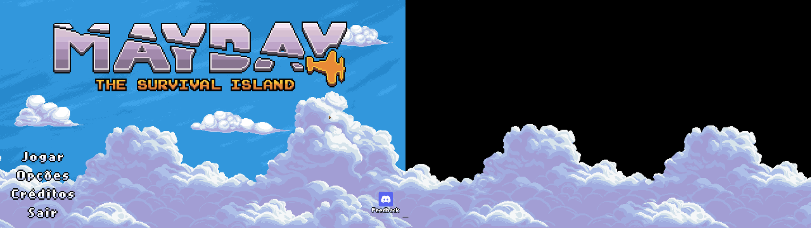
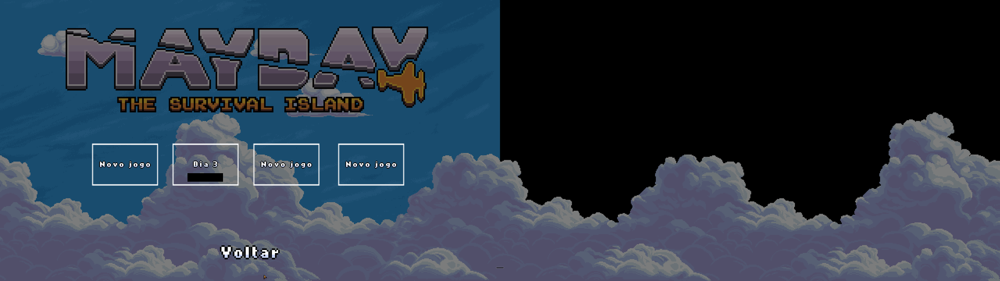
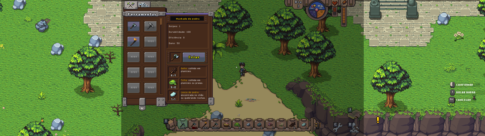
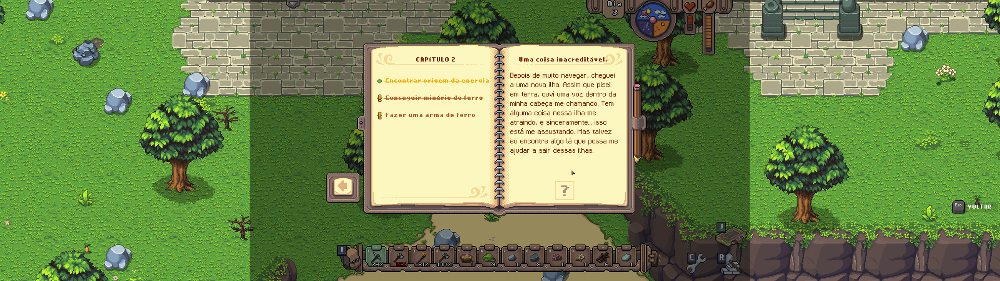
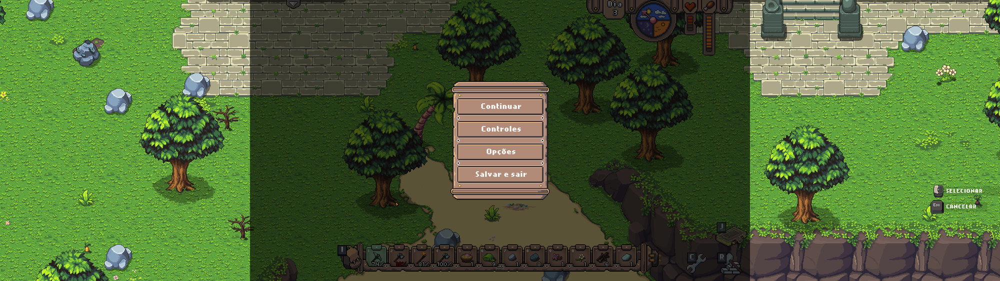

# Mayday 32:9

Projeto independente e não oficial sobre a possibilidade de jogar **Mayday: The Survival Island** em formato ultrawide. Não há vínculo nem endosso dos desenvolvedores.

## Imagens

As capturas abaixo retratam a experiência experimental e mostram os defeitos de interface ainda presentes — alinhamento e escurecimento de menus, painéis deslocados. Elas **não** demonstram correção nem compatibilidade.

*Tela inicial.*

*Seleção de jogo (data ocultada por privacidade).*

*Menu de ferramentas.*

*Livro de objetivos.*

*Menu de pausa.*

## Guia

Leia o [guia ultrawide](README-GUIA-ULTRAWIDE.md). A publicação inicial proposta é informativa: **não inclui patch nem procedimento validado para instalar 32:9**. O guia não garante compatibilidade com versões do jogo, resoluções ou computadores.

## Equipamento utilizado

- **Sistema operacional:** Windows 11
- **Placa de vídeo:** NVIDIA GeForce RTX 5080
- **Monitor:** Samsung LED 49 polegadas

## Situação e limitações

Segundo os desenvolvedores, o jogo oferece suporte oficial a **16:9**, e a possibilidade de suporte ultrawide está em estudo, sem prazo confirmado. Em testes locais parciais, houve relato de visão ampliada, mas também de problemas na interface; esses relatos não comprovam compatibilidade geral nem a correção de todos os problemas.

A área visível influencia o funcionamento do jogo: ampliar a imagem pode antecipar eventos ou causar outros efeitos não identificados. Os testes não cobrem toda a progressão.

## Fonte

- [Discussão oficial na comunidade Steam sobre suporte widescreen](https://steamcommunity.com/app/1686230/discussions/0/568175892570059494/).

## Licença

O conteúdo próprio deste projeto é disponibilizado sob a [licença MIT](LICENSE). Essa licença não se aplica ao jogo nem a conteúdo de terceiros, que permanecem sujeitos aos direitos e termos de seus respectivos titulares.

As imagens desta página retratam o jogo e seus elementos visuais. Os direitos sobre elas e sobre o conteúdo retratado pertencem aos respectivos titulares; a licença MIT **não** os cobre, **não** representa aprovação dos desenvolvedores e **não** autoriza uso irrestrito.
