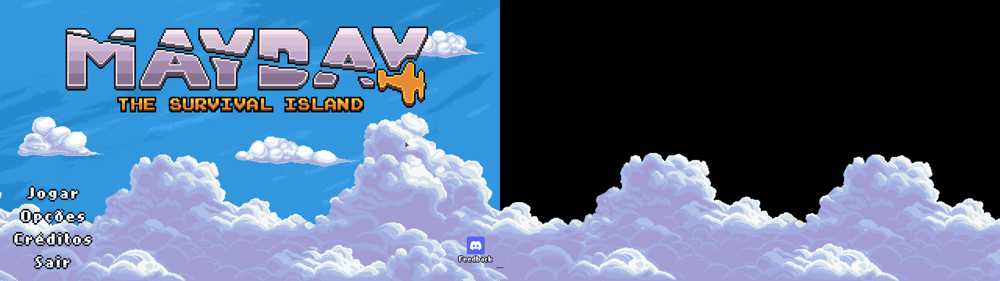
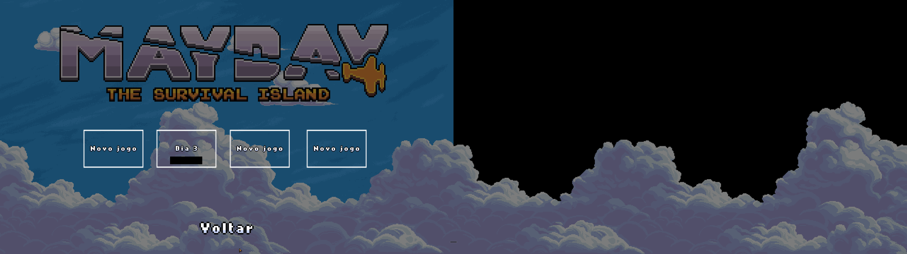
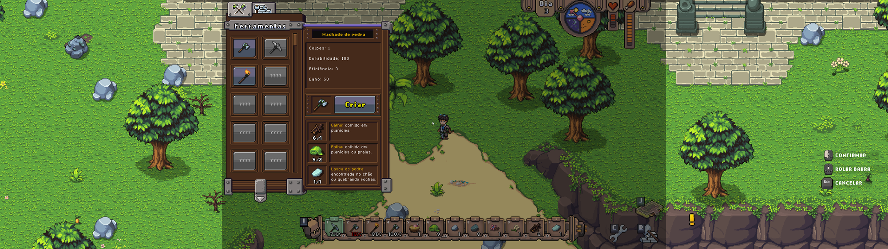
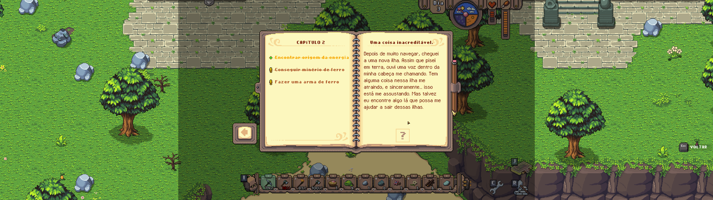
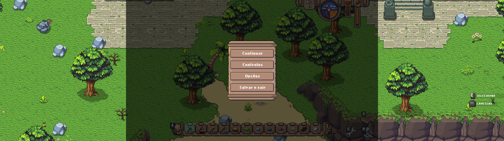

# Mayday 32:9

Relato independente e não oficial sobre jogar **Mayday: The Survival Island** (Steam, AppID 1686230) em ultrawide 32:9. Não há vínculo nem endosso dos desenvolvedores. Este repositório **não distribui** patch, script nem arquivos do jogo.

*English summary below.*

## Situação por build

| Build Steam | Data | Resultado |
| --- | --- | --- |
| 26409308 | 03/11/2026 | Alteração aplicada. Jogável em 32:9, com mais cenário e cliques corretos; menus com defeitos visuais. |
| 26448102 | 05/11/2026 | A atualização desfez a alteração; reaplicada. |
| 26839645 | 23/11/2026 | A atualização desfez a alteração e acrescentou três ações de tela cheia; reaplicada. Visual ainda em conferência. |

Toda atualização da Steam restaura o pacote original do jogo, então a alteração precisa ser refeita a cada build.

## O que foi alterado

Em termos de Construct 3, o motor do jogo:

1. **Modo de tela cheia**: `Letterbox scale` → `Scale outer`, na propriedade do projeto e em todas as ações *Request fullscreen*. As duas trocas são necessárias.
2. **Faixa de conquista** (camada `FANFARRA`): a animação de saída ia até um X fixo, que continua dentro da tela larga; o destino passou a ser relativo à borda esquerda do viewport.

Os detalhes para os desenvolvedores, com as expressões e as referências da documentação do Construct, estão na [issue #2](https://github.com/marlonmotta/mayday-32x9/issues/2).

## O que continua com defeito

- **Menu inicial**: o céu e o menu ocupam só a metade esquerda da tela; a direita fica preta.
- **Menus durante o jogo**: o escurecimento de fundo cobre só a área central 16:9.
- Os fundos e sobreposições de tela inteira têm 1280 de largura e não acompanham a tela larga. A correção precisa ser feita no projeto do jogo (sugestões na issue #2).

Os testes cobrem o começo do jogo. Segundo os desenvolvedores, as áreas de detecção dependem do que está visível, então ver mais cenário pode antecipar eventos.

## Imagens

Capturas em 32:9, feitas no começo de novembro de 2026. Mostram a visão ampliada funcionando e os defeitos de interface listados acima.

*Tela inicial: céu, título e menu presos à metade esquerda; à direita o fundo fica preto.*

*Seleção de jogo (data ocultada por privacidade).*

*Menu de ferramentas: visão ampliada, mas o escurecimento cobre só o centro.*

*Livro de objetivos.*

*Menu de pausa: o escurecimento não cobre as laterais.*

## Guia

O [guia ultrawide](README-GUIA-ULTRAWIDE.md) explica a situação oficial, o que dá para ajustar sem mexer nos arquivos do jogo e como relatar problemas ao desenvolvedor.

## Equipamento utilizado

- **Sistema operacional:** Windows 11
- **Placa de vídeo:** NVIDIA GeForce RTX 5080
- **Monitor:** Samsung 49 polegadas, 32:9

## English summary

Unofficial write-up about playing *Mayday: The Survival Island* at 32:9. No patch or game files are distributed here. Two changes make the wide view work: switching the fullscreen mode from *Letterbox scale* to *Scale outer* (project property **and** every *Request fullscreen* action), and making the achievement banner exit relative to the viewport instead of a fixed X. Menu backgrounds and dark overlays are still 1280 wide and only cover the centre. Every Steam update restores the original package. Details for the developers: [issue #2](https://github.com/marlonmotta/mayday-32x9/issues/2).

## Fonte

- [Discussão oficial na comunidade Steam sobre suporte widescreen](https://steamcommunity.com/app/1686230/discussions/0/568175892570059494/).

## Licença

O conteúdo próprio deste projeto é disponibilizado sob a [licença MIT](LICENSE). Essa licença não se aplica ao jogo nem a conteúdo de terceiros, que permanecem sujeitos aos direitos e termos de seus respectivos titulares.

As imagens desta página retratam o jogo e seus elementos visuais. Os direitos sobre elas e sobre o conteúdo retratado pertencem aos respectivos titulares; a licença MIT **não** os cobre, **não** representa aprovação dos desenvolvedores e **não** autoriza uso irrestrito.
